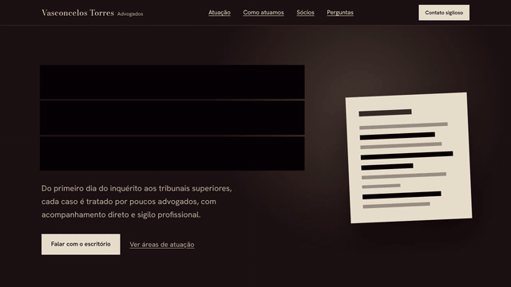
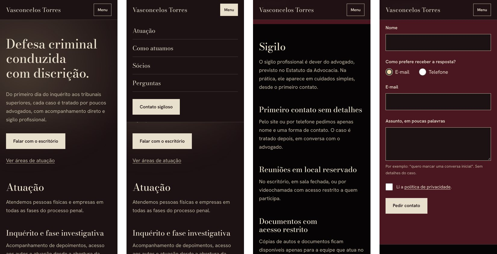

# Landing page: escritório de advocacia criminal (fictício)

[](https://github.com/aryelderyckcandeias-jpg/landing-escritorio-advocacia/actions/workflows/ci.yml)

**Página publicada:** https://aryelderyckcandeias-jpg.github.io/landing-escritorio-advocacia/

Projeto de portfólio: landing page de um escritório boutique de defesa criminal, com dois efeitos
visuais, acessibilidade, segurança, LGPD e testes automatizados em três navegadores. HTML, CSS e
JavaScript puros, sem framework e sem etapa de build.

> **Tudo aqui é fictício.** O escritório "Vasconcelos Torres Advogados", os sócios e os textos
> foram inventados. O formulário de contato é uma demonstração e **não envia nada**.






## O conceito

A página é um processo em segredo de justiça aberto sob uma lâmpada de mesa.

- **Tarjas:** os títulos começam cobertos por tarjas, como num documento sigiloso, e se abrem
  uma única vez, quando passam da linha de 75% da altura da tela (onde a pessoa está olhando).
- **Holofote:** na primeira tela, uma luz quente segue o cursor, com uma leve inércia. No
  celular, a luz percorre a tela sozinha e pausa quando a primeira tela sai da vista.
- Só esses dois efeitos existem. O resto da página é sóbrio de propósito.

Os efeitos nunca escondem texto: sem JavaScript, com movimento reduzido ou se o script falhar,
tudo fica legível.

## Como foi feito

A primeira versão foi escrita de uma vez. A segunda fase foi **verificar com ferramentas e
corrigir o que elas mostraram**, sempre com um teste que falhava antes da correção. Alguns
exemplos do que só apareceu medindo:

| Problema encontrado | Como foi medido | Resultado |
| --- | --- | --- |
| Título da primeira tela em 5 linhas no notebook, empurrando o botão para fora da tela | Largura das palavras × largura da coluna, em 5 tamanhos de tela | Título medido pela coluna (`cqi`): 3 linhas de 320 a 1920 px |
| Cedilha e "g" aparecendo por baixo da tarja fechada | Capturas da tarja fechada e contagem de pixels claros | 1.856 pixels vazados → 0, em 4 larguras |
| Botão do cabeçalho quebrando em 2 ou 3 linhas em 320, 360 e 430 px | Teste que conta as linhas de cada item do cabeçalho | Uma linha em 13 larguras |
| Título que não crescia com o zoom do navegador | Tamanho na tela com zoom de 200% | 1,0× → 1,8 a 2,0× |
| Conteúdo cortado com espaçamento de texto aumentado (WCAG 1.4.12) | Teste que aplica o espaçamento e procura o que sai da tela | Nada sai da tela em 6 larguras |
| Luz do holofote voltando a andar fora da tela ao trocar de aba | Teste em tela de toque simulando a troca de aba | Pausa mantida |
| Firefox lendo vazio o `autocomplete` definido pela propriedade JavaScript | CI rodando os testes no Firefox | Passou a usar o atributo; passa nos 3 navegadores |
| Títulos ainda tarjados saindo cobertos na impressão | PDF gerado pelo navegador e teste com mídia de impressão | `print.css`: tinta escura, sem tarja, sem navegação |
| Botões sem contorno no modo de alto contraste do Windows | Captura com `forced-colors` | Borda transparente, que o sistema desenha; tamanho idêntico |
| Perna do "g" aparecendo sob a tarja só no WebKit (Safari) | Teste de cobertura no CI e medição da tinta nos 3 navegadores | Altura de linha 1,2 nos títulos tarjados, com folga nas duas pontas |
| Tarja invisível na seção de fundo preto | Teste que compara a cor da tarja com o fundo de cada título | Faixa em mogno nessa seção |

O processo completo está nos documentos de projeto: [especificação](docs/superpowers/specs/2026-10-27-landing-escritorio-design.md)
e [plano](docs/superpowers/plans/2026-10-27-landing-escritorio-implementacao.md).

## Qualidade verificada por ferramenta

| O quê | Ferramenta | Resultado |
| --- | --- | --- |
| Testes unitários | `node:test` | 40 testes: validação do formulário, contraste das cores (inclusive sob a luz do holofote), tipografia e zoom, publicação, CSP, fontes |
| Testes E2E | Playwright | 77 testes, no **Chromium, Firefox e WebKit** (motor do Safari), a cada push |
| Acessibilidade | axe-core | 0 violações nas 3 páginas, inclusive com as regras da WCAG 2.2 e de boas práticas |
| HTML | html-validate | 0 erros nas 3 páginas |
| Desempenho e boas práticas | Lighthouse (celular, rede lenta simulada) | 100 em Desempenho, Acessibilidade e Boas práticas, nas duas páginas |
| Dependências | `npm audit` | 0 vulnerabilidades |
| Aparelhos reais | Teste manual | Versão de 28/10/2026 conferida num Android e num iPhone; as mudanças de 02/11 e 05/11 ainda não |

## Decisões

| Decisão | Motivo |
| --- | --- |
| Fontes hospedadas no repositório | Google Fonts envia o IP do visitante a terceiros (LGPD) e atrasa a página. |
| Nenhum recurso de terceiros, sem cookies | Não há o que consentir, então não há banner de cookies. |
| `Content-Security-Policy` por `<meta>` | O GitHub Pages não deixa configurar cabeçalhos HTTP. |
| Tarjas só existem com `html.js` | Melhoria progressiva: sem JavaScript, o texto aparece normalmente. |
| `marca-js.js` com prazo de 3 s | Se `main.js` falhar, a marca `js` é removida e nenhum título fica coberto. |
| Tarja abre com limiar 0 e `rootMargin` de -25% | Abre onde a pessoa olha; com limiar 0, até um título mais alto que a tela (zoom grande) abre. |
| `noindex` | O escritório é fictício e não deve ser indexado como se fosse real. |
| Testes unitários sem dependências (`node:test`) | Funções de validação são puras e rápidas de testar. |
| Título da primeira tela medido pela coluna (`cqi`) | Fica nas mesmas 3 linhas de 320 a 1920 px; em celular deitado também respeita a altura (`svh`). |
| Tipografia fluida com máximo ≤ 2,5 × mínimo | Condição para o zoom do navegador conseguir dobrar o texto (WCAG 1.4.4); há teste unitário. |
| Vão da tarja no topo de cada linha | A faixa cobre acentos e descendentes (ç, g, q); medido com capturas da tarja fechada. |
| Ajustes do holofote em variáveis (`--holofote-*`) | Dá para experimentar; um teste barra uma força de luz que derrube o contraste do texto. |
| Menu do celular com `<details>` | Funciona sem JavaScript; o script só fecha o menu ao escolher um link, com Esc ou ao tocar fora. |
| Perguntas com `<details name>` | Abrir uma fecha a outra sem JavaScript. |
| Triângulo das perguntas desenhado pelo CSS | O marcador nativo do `<summary>` muda de navegador para navegador (Safari). |
| Hover só em `(hover: hover)` | No toque, o hover ficaria ativo depois do toque. |
| `404.html` com `<base>` | O Pages mostra a 404 em qualquer profundidade de endereço; sem o `<base>`, os estilos quebram. |
| Prévia de compartilhamento (Open Graph) com endereço completo | É o que o WhatsApp e o LinkedIn leem; única exceção aos caminhos relativos, além do `<base>`. |
| `print.css` com `media="print"` | Impressão legível e sem tarja; não atrasa a página na tela. |
| Fontes pré-carregadas (`preload`) | Chegam antes da primeira pintura: FCP de 1,5 s para 1,1 s e nenhum deslocamento de layout. |
| `color-scheme: dark` | Caixas de seleção, botões de opção e barras de rolagem nativos no tema escuro. |
| Escolha e-mail/telefone começa com `hidden` | Aparece só quando o script que lhe dá efeito roda (mesmo com internet lenta). |
| CSP sem `data:` e igual nas três páginas | Nada usa imagens embutidas; um teste confere o CSP. |

## Acessibilidade

- HTML semântico, `lang="pt-BR"`, link para pular ao conteúdo e foco visível.
- Formulário com rótulos, erros em texto ligados aos campos e anunciados por `aria-live`;
  campos obrigatórios indicados (WCAG 3.3.2) e aviso quando não há JavaScript.
- Sem rolagem horizontal de 320 px em diante, com zoom de 200% e de 400% (WCAG 1.4.10).
- Texto ampliável com o zoom do navegador (WCAG 1.4.4) e espaçamento de texto aumentado sem
  perda de conteúdo (WCAG 1.4.12).
- Alvos de toque com pelo menos 24 × 24 px (WCAG 2.5.8).
- Contraste mínimo de 4,5:1, verificado por teste, inclusive no ponto mais claro da luz.
- `prefers-reduced-motion`: sem tarja, sem animação, luz parada.
- Modo de alto contraste do Windows (`forced-colors`): botões com contorno e triângulo das
  perguntas visível.
- O menu do celular fecha quando o foco sai dele, para não cobrir o elemento focado (WCAG 2.4.11).
- Links que abrem em nova aba avisam leitores de tela.
- Impressão legível, sem tarja nem navegação.

## Segurança e LGPD

- Sem requisições a domínios externos (verificado por teste automatizado).
- CSP com `default-src 'self'` e `form-action 'none'`; o formulário não envia dados, e um teste
  confirma que não há requisição de rede nem tentativa barrada pelo CSP.
- Links externos com `rel="noopener noreferrer"`.
- Campo oculto (honeypot) contra envio automático.
- Política de privacidade em `privacidade.html`.

### Como seria a versão real do formulário

1. Backend próprio ou serviço de formulários, sempre por HTTPS.
2. Captcha ou limite de requisições, além do honeypot.
3. Base legal e finalidade informadas (consentimento ou procedimentos preliminares de contrato).
4. Retenção mínima, com prazo de exclusão definido.
5. Canal para o titular exercer seus direitos (LGPD, art. 18).
6. Aviso para não enviar detalhes do caso pelo formulário (já presente aqui).

## Como rodar

Requisitos: Node.js 22.22 ou superior (ou 24.8+), exigido pelo validador de HTML.

```bash
npm ci                 # instala as dependências nas versões do package-lock.json
npm run serve          # abre em http://127.0.0.1:4173
npm run serve:pages    # imita o GitHub Pages: /landing-escritorio-advocacia/ e a página 404
```

As fontes já estão commitadas em `assets/fonts/`. `npm run fonts` só é necessário se o pacote
das fontes for atualizado (o CI confere se os arquivos batem com o pacote).

Testes:

```bash
npx playwright install chromium   # uma vez, para os testes E2E
npm run test:unit                 # formulário, contraste, tipografia e zoom, publicação
npm run test:e2e                  # efeitos, formulário, menu, rede, responsividade, 404, axe
npm run lint:html                 # validador de HTML
```

Para rodar os E2E em outro navegador, instale-o (`npx playwright install firefox` ou `webkit`) e
defina a variável `NAVEGADOR`: `NAVEGADOR=firefox npm run test:e2e` no Linux e no macOS, ou
`$env:NAVEGADOR="firefox"; npm run test:e2e` no PowerShell do Windows.

## Limitações conhecidas

- **CSP por `<meta>`** não suporta `frame-ancestors` e outras diretivas; cabeçalhos HTTP reais
  exigiriam outra hospedagem.
- A página usa `1lh` (unidade de altura de linha) nas tarjas, presente em navegadores atuais
  (Chrome 109+, Safari 16.4+, Firefox 120+). Em navegadores mais antigos as faixas por linha
  não aparecem, mas o texto continua legível.
- O título usa `cqi` (Chrome 105+, Safari 16+, Firefox 110+). Sem suporte, vale o tamanho
  de reserva (`--texto-6`).
- Com zoom de exatamente 200%, os títulos de seção crescem de 1,55 a 1,9 vez, não 2 vezes
  (o tamanho fluido acompanha a janela, que encolhe com o zoom). Eles chegam ao dobro com um
  pouco mais de zoom; o texto corrido dobra normalmente.
- Os testes automáticos de celular usam navegador emulado e o WebKit do Playwright (o motor do
  Safari, mas não o Safari do iPhone). Em 28/10/2026 a página publicada também foi conferida à
  mão num Android e num iPhone; as mudanças de 02/11 e 05/11/2026 ainda precisam dessa conferência.
- O Lighthouse roda no CI só em pull requests (a nota de desempenho oscila e não deve travar a
  publicação); os números acima são de execuções locais.
- Na impressão, as respostas das perguntas frequentes saem só se estiverem abertas.
- Auditoria de SEO do Lighthouse fica fora das metas por causa do `noindex`.

## Estrutura

```text
index.html, privacidade.html, 404.html
assets/css/     fonts, tokens, base, layout, components, effects, print
assets/js/      marca-js, main, reveal, spotlight, menu, form, form-validation
assets/fonts/   fontes woff2 e licenças
assets/         favicon, ícone da tela inicial, imagem da prévia
tests/unit/     form-validation, contraste, tipografia, publicação
tests/e2e/      tarjas, tarja-cobertura, formulário, menu, página, primeira-tela, cabeçalho,
                espaçamento, impressão, github-pages, axe
scripts/        serve.cjs (servidor estático), copiar-fontes.mjs, resumo-falhas.sh (CI)
docs/           imagens do README, especificação e plano
```

## Publicação

GitHub Pages por Actions (`pages.yml`): a cada push na `main`, os testes rodam e, só se passarem,
a página é publicada. O mesmo `ci.yml` roda em qualquer branch, nos três navegadores, e resume
as falhas numa anotação da execução.
